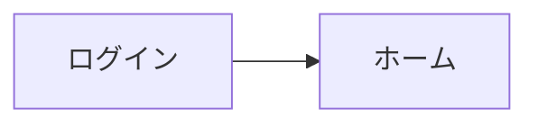

# ページを書く

このファイルは markus が書き換えます（markus の規約）。変えないでください。決まりを足すときは、AGENTS.md の「このプロジェクトの決まり」に書いてください。

ページ（`docs/` の `.md`）や DB の行の本文を作る・書き換えるときの決まりです。

## 1. ページのファイル

- ページは `.md` ファイル。フォルダはディレクトリ。
- ページは必ず `docs/` の下に置く。`docs/` の外に置いた `.md` は markus の Web に出ない。
- ファイル名はページタイトルから作る。正式なタイトルは frontmatter の `title`。
  - ファイル名に使えない文字 `/ \ : * ? " < > |` は全角にする（`/` → `／`）。長さはタイトルの先頭 50 文字まで。同じフォルダに同じ名前があれば「 2」を付ける（`無題 2.md`）。
- frontmatter は `ulid`・`title`（必須）と `rank`（任意）だけ。通常のページにほかのプロパティは付けない（プロパティを持つのは DB の行だけ）。

```yaml
---
ulid: 01JB8Z6Q3K4M5N6P7R8S9T0V1W   # ULID（markus がページを見分ける内部の ID）。新しいページを作るときは、今の時刻から自分で生成する
title: ログイン機能
---
```

- 既存の `ulid` は変えない。コピーして新しいページを作ったときは、新しい `ulid` を振り直す。
- 知らないキーがあっても消さない・並び替えない。
- 本文の先頭にタイトルの見出し（`# タイトル`）は書かない。タイトルは `title` だけに持つ。
- `rank` は同じフォルダの中での並び順。新しいページでは省略してよい（タイトル順になる）。
- フォルダの並び順は、そのフォルダの `_folder.yml` の `rank`。新しいフォルダでは作らなくてよい。
- 内部リンクはリンク先の `ulid` で書く: `[パスワード再設定](markus:01M40K9K80H877GNPBH4V44450)`。表示文字列はリンク先のタイトルにする。

## 2. 本文の記法

GFM を基本に、次の markus の記法を使う。ここに無いタグや記法は作らない（markus で開くと文字のまま出たり、消えたりする）。書き方に迷ったら、markus の Web で保存されたページ（コミットの author が markus の App のもの）の書き方を真似る。

````markdown
パスワードは<span color="red">8 文字以上</span>にする。<span color="yellow_bg">背景色</span>も付けられる。

<callout icon="⚠️" color="yellow_bg">

**注意**: 中に Markdown を書くときは、開始タグの後と終了タグの前に空行を入れる。

</callout>

<details color="gray">
<summary>詳しい手順</summary>

折りたたむ中身。

</details>

<table header-row="true" header-column="false">
  <colgroup>
    <col width="200">
    <col>
  </colgroup>
  <tr color="gray_bg">
    <td>項目</td>
    <td>内容</td>
  </tr>
  <tr>
    <td>パスワード</td>
    <td color="red">**8 文字以上**<br>英字と数字を両方含む</td>
  </tr>
  <tr>
    <td>ロック</td>
    <td>5 回失敗で 15 分</td>
  </tr>
</table>


<embed src="https://media.markus.ink/.../仕様書.pdf" type="application/pdf" title="仕様書.pdf" height="600">

<video src="https://.../demo.mp4" poster="https://.../poster.jpg" title="ログインの流れ"></video>

&nbsp;



```html height="400"
<!DOCTYPE html>
<html>（画面のモック）</html>
```

```markus-db
database: タスク
type: board
```

```markus-sheet
sheet: 予算
tab: 月別
```
````

- 表は必ず `<table>` で書く。GFM の表（`| a | b |`）では書かない（色・幅・見出しの指定が書けず、Web で保存したときに全部書き直される）。
  - `header-row`（1 行目を見出しにする）と `header-column`（1 列目を見出しにする）は両方書く。見出しのセルも `<td>` で書く。
  - 色は `<col color>`（列）・`<tr color>`（行）・`<td color>`（セル）、幅は `<col width>`（px）。要らなければ `<colgroup>` は書かなくてよい。
  - セルの中は 1 行の Markdown で、改行は `<br>`。
- 色の名前は `gray` `brown` `orange` `yellow` `green` `blue` `purple` `pink` `red`。背景色は `_bg` を付ける（`yellow_bg`）。`style` 属性や 16 進数の色コードは書かない。
- `` は高さを決めるときだけ使う。決めないなら ``。
- ` ```html ` はコードではなく、動く画面（画面のモックなど）になる。`<!DOCTYPE html>` から始まる 1 つの文書で書く。
- ` ```markus-db `・` ```markus-sheet ` は DB・シートの埋め込み。書ける項目は `databases.md`・`sheets.md` を読む。
- `&nbsp;` だけの段落は、Web で入れた何も書いていない行。消さない。

次の書き方は markus には無い。書かないで、右の書き方にする。

| 書かない | 代わりに |
|---|---|
| `<columns>`・`<column>`（横に並べる） | ブロックは縦に 1 列に並べる |
| `<empty-block/>` | `&nbsp;` だけの段落 |
| 段落の後ろの `{color="red"}` | `<span color="red">…</span>` |
| `<mention-page>`・`<page>` | `[タイトル](markus:<ulid>)`（3） |
| `<mention-user>`・`<mention-date>` | 名前や日付を文字で書く |
| `<table_of_contents/>` | 書かない（目次のブロックは無い） |
| `> [!NOTE]` などの Alert | `<callout>` |
| `$…$`（数式）・`[^1]`（脚注） | 書かない（markus では表示できない） |

次の 5 つは、間違えても後の整形で見つからない（別の意味の正しい Markdown になる）ので、書くときに気を付ける。

- 太字・斜体・取り消し線の中身の最初か最後が記号（「」、。（）など）のときは、`**` `*` `~~` でなく `<strong>` `<em>` `<s>` で書く（`前の**「重要」**後` は太字にならない）。中には Markdown を書いてよい。
- 見出しと ToDo の項目の文章の中の改行は `<br>`。
- 文章の行の頭にブロックの記号（`# ` `- ` `1. ` `> ` ```` ``` ```` `---`）を文字として書くときは `\` を付ける（`\- `・`1\. `）。
- URL をリンクにするときは `[文字](URL)` か `<URL>` で書く。文字のすぐ後ろの URL（`名前https://…`）はリンクにならない。
- コードフェンスの中に ```` ``` ```` を書くときは、それより長いフェンス（````` ```` `````）で囲む。

## 3. 画像・PDF

- 画像・PDF はリポジトリに置かない。markus の Web でアップロードした URL（`https://media.markus.ink/...`）を使う。
- 画像の代替テキストには、画像の内容を文章で書く。GIF は最初のコマしか見えないので、動きも文章で書く。
- 動画はアップロードできない。ほかで公開されている動画の URL を `<video>` で置く。

## 4. 整形

- `.md`（ページ・DB の行・テンプレート）を書き終えたら、書き換えたファイルを渡して整形する: `node .markus/fmt.mjs docs/機能/ログイン.md …`
  - Web で保存したときと同じ書き方に直る（箇条書きの記号・字下げ・空行・表の形など）。この細かい書き方は気にしなくてよい。
  - 直せない所は `ファイル:行 理由` の形で出る（そのファイルは書き換わらない）。読んで直し、何も出なくなるまで繰り返す。
  - 自分が書き換えていないファイルには実行しない（人が書いた所や、同期している間の Web の書きかけまで書き換わるため）。
- 本文の文を書き換えて、コメントの対象の文が変わったときは、コメントも合わせる（`comments.md`）。
