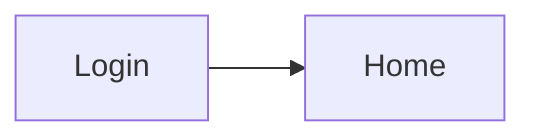

# Writing pages

Markus rewrites this file (Markus rules). Do not change it. To add rules, write them under "Project rules" in AGENTS.md.

These are the rules for creating or changing pages (`.md` in `docs/`), side pages (`.md` in `sidepages/`), and the body of database rows.

## 1. Page files

- A page is a `.md` file. Folders are directories.
- Always put pages under `docs/`. A `.md` placed outside `docs/` doesn't appear on the Markus web.
- The file name is made from the page title. The real title is `title` in the frontmatter.
  - Replace characters that can't be used in file names, `/ \ : * ? " < > |`, with their full-width forms (`/` → `／`). Use at most the first 50 characters of the title. If the same name already exists in the folder, add " 2" (`Untitled 2.md`).
  - A page or row created on the Markus web may have a file name like `Untitled 7KQX.md` ("Untitled" and the last 4 characters of its ulid; `無題 7KQX.md` in Japanese), `Untitled.md` or `Untitled 2.md` until it's saved on the web, even though it has a title. This is normal: don't rename the file, write to it as it is, and don't point it out to the person. Markus renames it to match the title when that page is saved.
- The frontmatter has only `ulid`, `title` (required), and `rank` and `icon` (optional). Don't add other properties to regular pages (only database rows have properties).
- `icon` is one emoji used as the page's icon (`icon: 🔐`; on the web it shows left of the title and in the sidebar). Don't add or change it unless asked. Database rows and side pages work the same way.

```yaml
---
ulid: 01JB8Z6Q3K4M5N6P7R8S9T0V1W   # ULID (the internal ID Markus uses to identify the page; it starts with the creation time). You don't need to write it for a new page (formatting adds it)
title: Login
---
```

- Don't change an existing `ulid`. When you create a new page by copying one, delete the `ulid` line and run the formatter (a new `ulid` is added). Don't write one by hand by imitating another example's `ulid` (the time would be wrong).
- If you need a ULID before formatting (for example, to link to the page), create one with `node .markus/fmt.mjs --ulid`.
- Don't delete or reorder keys you don't know.
- Don't write the title as a heading at the top of the body (`# Title`). The title lives only in `title`.
- `rank` is the order within the same folder. You may omit it for new pages (they are sorted by title).
- A folder's order is the `rank` in that folder's `_folder.yml`. You don't need to create it for a new folder.
- Write internal links with the target's `ulid`: `[Password reset](markus:01M40K9K80H877GNPBH4V44450)`. Use the target's title as the link text.

### Side pages

- A page placed inside a page. It doesn't appear in the sidebar. When someone asks you to "create a page inside a page", make it a side page.
- The file is `sidepages/<title>.md` (don't create a folder per parent). The frontmatter is the same as a page: `ulid` and `title`. File names follow the same rules as pages.
- In the parent page's body, write the following block where you want it. Only one block in the whole repository may point to a given side page. To place it somewhere else too, copy the side page, give it a new `ulid`, and write a block for the copy.

```markus-page
ulid: 01JC2M4N6P8R0S2T4V6W8X0Y2Z
```

- Side pages can contain side pages (those also go directly under `sidepages/`).
- To delete a side page, delete both the file and the block. If you delete only the block, the file remains.

## 2. Body syntax

Use GFM as the base, plus the Markus syntax below. Don't invent tags or syntax that aren't listed here (Markus shows them as plain text or drops them). If you're unsure how to write something, imitate pages saved from the Markus web (commits whose author is the Markus App).

````markdown
Passwords must be <span color="red">at least 8 characters</span>. You can also add a <span color="yellow_bg">background color</span>.

<callout icon="⚠️" color="yellow_bg">

**Note**: When you write Markdown inside, put a blank line after the opening tag and before the closing tag.

</callout>

<details color="gray">
<summary>Detailed steps</summary>

The collapsed content.

</details>

<table header-row="true" header-column="false">
  <colgroup>
    <col width="200">
    <col>
  </colgroup>
  <tr color="gray_bg">
    <td>Item</td>
    <td>Rule</td>
  </tr>
  <tr>
    <td>Password</td>
    <td color="red">**At least 8 characters**<br>Must include both letters and numbers</td>
  </tr>
  <tr>
    <td>Lockout</td>
    <td>15 minutes after 5 failed attempts</td>
  </tr>
</table>


 

<embed src="https://media.markus.ink/.../spec.pdf" type="application/pdf" title="spec.pdf" height="600">

<video src="https://.../demo.mp4" poster="https://.../poster.jpg" title="Login flow"></video>

<iframe src="https://www.youtube.com/embed/dQw4w9WgXcQ?start=90" height="400"></iframe>

<bookmark href="https://developer.mozilla.org/en-US/docs/Web/HTTP/CORS" title="Cross-Origin Resource Sharing (CORS) - HTTP | MDN" description="..." image="https://..." icon="https://..."></bookmark>

&nbsp;



```html height="400"
<!DOCTYPE html>
<html>(a screen mockup)</html>
```

```markus-db
database: Tasks
type: board
```

```markus-sheet
sheet: Budget
tab: Monthly
```
````

- Always write tables with `<table>`. Don't use GFM tables (`| a | b |`) (they can't express colors, widths, or headers, and are fully rewritten when saved on the web).
  - Always write both `header-row` (make the first row a header) and `header-column` (make the first column a header). Write header cells with `<td>` too.
  - Colors go on `<col color>` (column), `<tr color>` (row), and `<td color>` (cell); widths go on `<col width>` (px). If you don't need them, you can leave out `<colgroup>`.
  - Each cell is one line of Markdown; use `<br>` for line breaks.
- Color names are `gray` `brown` `orange` `yellow` `green` `blue` `purple` `pink` `red`. For background colors, add `_bg` (`yellow_bg`). Don't use `style` attributes or hex color codes.
- Use `` only when you set the height. Otherwise use ``.
- Write the `height` of images, videos, PDFs, YouTube, and ` ```html ` as a multiple of 50 (at least 50; up to 750 for images and videos), because the web resizes them in 50px steps.
- A line with only images (and `<video>`s) separated by single spaces becomes a block of side-by-side images (a gallery). Don't put text on that line. If you set the height, give every image the same `height`.
- ` ```html ` is not code; it becomes a live screen (such as a screen mockup). Write it as a single document starting with `<!DOCTYPE html>`.
- ` ```markus-db ` and ` ```markus-sheet ` embed a database or sheet. For the keys you can write, read `databases.md` and `sheets.md`. ` ```markus-page ` is a side page (1).
- A paragraph containing only `&nbsp;` is an empty line someone added on the web. Don't delete it.

Markus doesn't have the following. Don't write them; use what's on the right instead.

| Don't write | Instead |
|---|---|
| `<columns>`, `<column>` (side by side) | Stack blocks vertically in one column (only images may share a line: the gallery above) |
| `<empty-block/>` | A paragraph containing only `&nbsp;` |
| `{color="red"}` after a paragraph | `<span color="red">…</span>` |
| `<mention-page>` | `[Title](markus:<ulid>)` (1) |
| `<page>` (a page inside a page) | A side page ("Side pages" in 1) |
| `<mention-user>`, `<mention-date>` | Write the name or date as text |
| `<table_of_contents/>` | Don't write it (there is no table of contents block) |
| Alerts such as `> [!NOTE]` | `<callout>` |
| `$…$` (math), `[^1]` (footnotes) | Don't write them (Markus can't display them) |

The following 7 mistakes are not caught by the formatter afterwards (they become valid Markdown with a different meaning), so be careful when writing.

- When the content of bold, italic, or strikethrough starts or ends with punctuation (quotes, parentheses, periods, colons, etc.), write `<strong>` `<em>` `<s>` instead of `**` `*` `~~` (`**Note:**next` and `the**"key"**part` are not bold). You may write Markdown inside the tags.
- Line breaks inside the text of headings and to-do items are `<br>`.
- When text at the start of a line begins with a block marker (`# ` `- ` `1. ` `> ` ```` ``` ```` `---`) that you mean as text, add `\` (`\- `, `1\. `).
- To make a URL a link, write `[text](URL)` or `<URL>`. A URL right after text (`namehttps://…`) doesn't become a link.
- To write ```` ``` ```` inside a code fence, wrap it in a longer fence (````` ```` `````).
- To put an image or gallery under a list item, leave a blank line after the item's text and indent it (without the blank line, the image becomes part of the item's text).
- Never write line breaks in image or video captions as is; write every one as `&#10;` (a raw line break cuts the caption at a blank line or a line starting with "#", "-", ">", etc., and it is no longer an image or video). Write an image with line breaks as ``, not `![...]`. For videos, write `title` the same way. Write `"` inside `alt` and `title` as `&quot;`.

## 3. Images, videos, and PDFs

- Don't put images, videos, or PDFs in the repository. Use URLs uploaded to Markus (`https://media.markus.ink/...`). To upload one as an AI, run `node .markus/media.mjs upload <file>…` and write the URL it prints as ``, `<video src="URL" title="...">`, or `<embed src="URL" type="application/pdf" title="file name">`.
- In an image's alt text, describe what the image shows in sentences. Only the first frame of a GIF is visible, so describe the motion in words too.
- An `` with `data-figma` is a Figma block. Don't create one as an AI (people place the zip exported with the Figma plugin on the web). When you move one, move `data-figma` with it and don't delete it (without it, the block becomes a plain image and the layers can no longer be viewed).
- Place videos with `<video>` (`title` is the caption). For YouTube videos, use `<iframe src="https://www.youtube.com/embed/<ID>">` (start position with `?start=<seconds>`). Don't write any other `<iframe>`.
- To show a link as a card, write `<bookmark href="<URL>" title="<title>"></bookmark>`. Add `description`, `image` (thumbnail URL), and `icon` (icon URL) if you know them. In attribute values, write `"` as `&quot;` and `&` as `&amp;`, and don't include line breaks.
- Write `<iframe>` and `<bookmark>` on a single line at the start of the line, with a blank line before and after.

## 4. Formatting

- When you finish writing `.md` files (pages, side pages, database rows, templates), `_database.yml`, `_sheet.yml`, or comments, pass the files you changed to the formatter: `node .markus/fmt.mjs docs/Features/Login.md …`
  - It adds a `ulid` if there is none. A malformed `ulid`, a time in the future, or an old time on a new file (copied from another file) are reported as problems it can't fix.
  - It rewrites the file the same way the web writes it when saving (list markers, indentation, blank lines, table layout, etc.). You don't need to worry about these details.
  - Problems it can't fix are printed as `file:line reason` (that file is not changed). Read them, fix them, and repeat until nothing is printed.
  - If you wrote two blocks pointing to the same side page, it turns the second and later ones into duplicate side pages (new files).
  - Don't run it on files you didn't change (it would also rewrite what people wrote and, while syncing, the web draft).
- When you change body text and the text a comment points to changes, update the comment too (`comments.md`).
